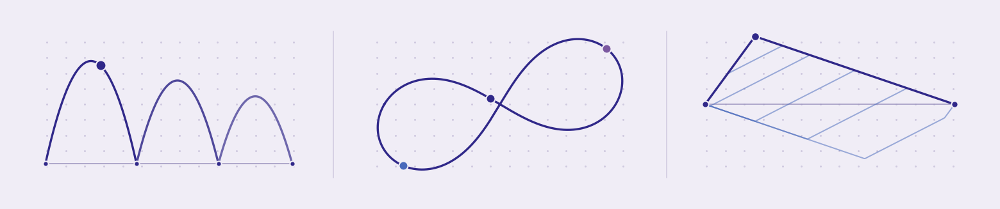

# Physics Simulation Workshop

*Workshop 01 · E-Physics · EMINES–UM6P*

Write the time-stepping code in each Python notebook and watch your model run.

| Exercise | What you'll investigate | Solution |
| --- | --- | --- |
| [Bouncing ball](notebooks/1.%20Bouncing%20ball.ipynb) | Add gravity and see how restitution changes each bounce. | [View](notebooks%20solutions/1.%20Bouncing%20ball.ipynb) |
| [N-body gravity](notebooks/2.%20N%20Body.ipynb) | Track energy drift in a figure-eight orbit with Euler and velocity Verlet. | [View](notebooks%20solutions/2.%20N%20Body.ipynb) |
| [Waves on a string](notebooks/3.%20Wave%20on%20a%20chord.ipynb) | Model a plucked string with finite differences and export its sound as a WAV file. | [View](notebooks%20solutions/3.%20Wave%20on%20a%20chord.ipynb) |

## Run the notebooks

[**Download the workshop bundle and follow the setup guide**](https://txt.ma/workshop1/)

Extract the bundle for your operating system and run its setup script. Open the folder in desktop VS Code with the Python and Jupyter extensions, then select the `.venv` kernel. The bundle includes the helper modules and media used by the notebooks. Close each simulation window before running the next cell.

---

**E-Physics** · [Instagram](https://www.instagram.com/emines.physics/) · [YouTube](https://www.youtube.com/@EminesEPHYSICS)
